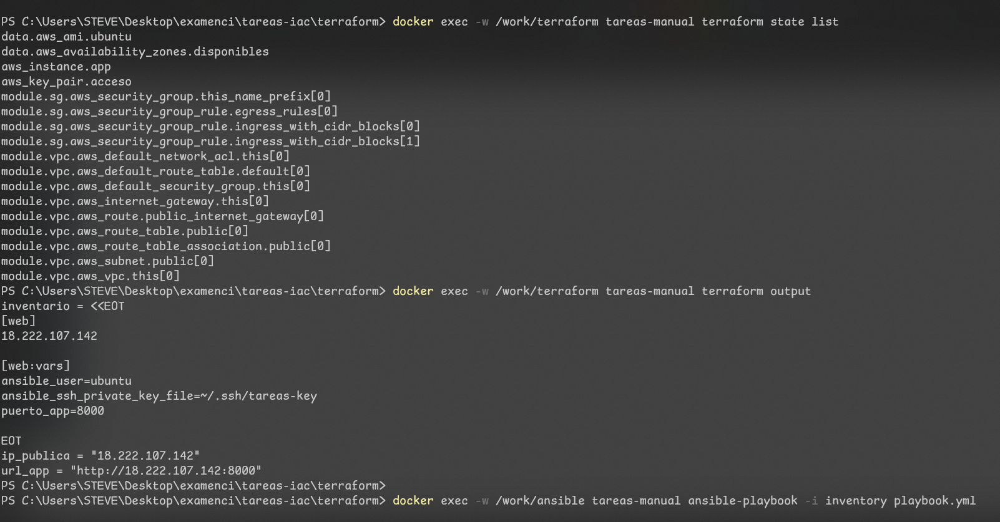
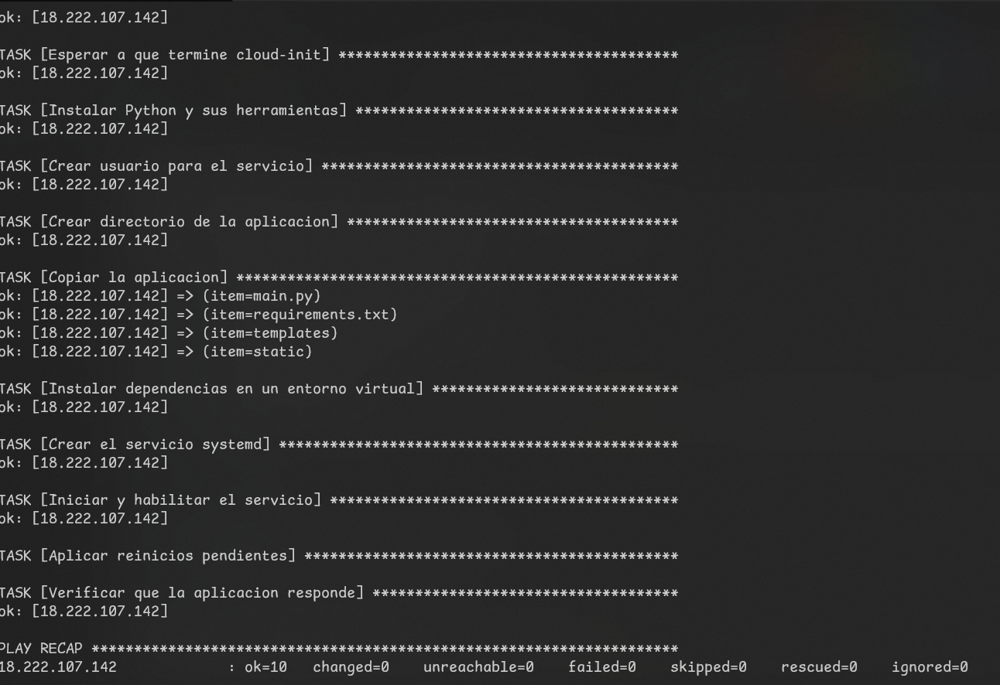
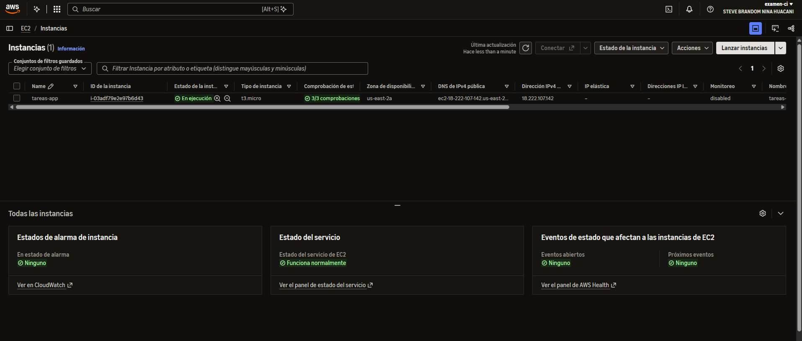
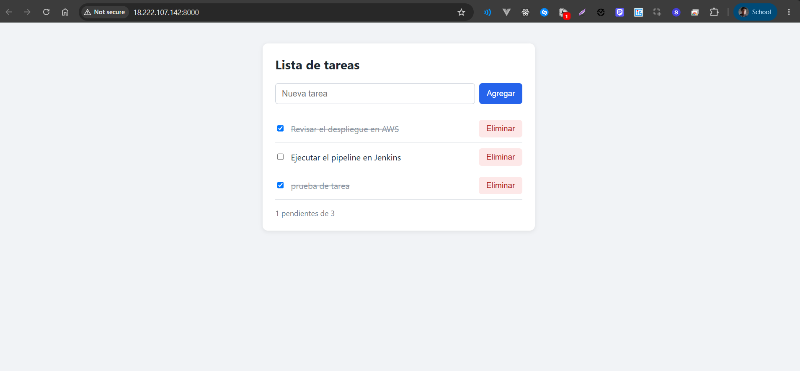

# Tareas IaC

Aplicación web pequeña para manejar una lista de tareas, hecha en Python con Flask, junto con la infraestructura como código para desplegarla en AWS: Terraform crea la instancia EC2 y su red, Ansible instala la aplicación como servicio y un Jenkinsfile automatiza todo el proceso.

Examen final del Módulo 3 del curso de DevOps (Infraestructura como Código y CI/CD Avanzado).

## Estructura

```
.
├── app/
│   ├── main.py
│   ├── requirements.txt
│   ├── templates/index.html
│   ├── static/
│   └── tests/test_basic.py
├── terraform/
│   ├── main.tf
│   ├── network.tf
│   ├── variables.tf
│   ├── outputs.tf
│   └── terraform.tfvars.example
├── ansible/
│   ├── ansible.cfg
│   ├── inventory
│   ├── playbook.yml
│   └── templates/tareas.service.j2
├── jenkins/
│   ├── Dockerfile
│   └── docker-compose.yaml
└── Jenkinsfile
```

## Requisitos

- Python 3.10 o superior
- Terraform 1.9 o superior
- Ansible (en Linux, macOS o WSL)
- Una cuenta de AWS con un usuario IAM que tenga permisos sobre EC2 y VPC

## Aplicación

| Método | Ruta | Descripción |
|--------|------|-------------|
| GET | `/` | Interfaz web |
| GET | `/health` | Estado de la aplicación |
| GET | `/api/tareas` | Lista las tareas |
| POST | `/api/tareas` | Crea una tarea, recibe `{"titulo": "..."}` |
| PUT | `/api/tareas/<id>` | Actualiza `titulo` o `completada` |
| DELETE | `/api/tareas/<id>` | Elimina una tarea |

Las tareas se guardan en memoria, así que se pierden al reiniciar el servicio.

Para ejecutarla en local:

```bash
python3 -m venv .venv
source .venv/bin/activate
pip install -r app/requirements.txt
cd app
python main.py
```

Queda disponible en http://localhost:8000

Para correr las pruebas, desde la carpeta `app`:

```bash
python -m pytest -v
```

## Variables y credenciales

La región y las credenciales de AWS se manejan con variables de Terraform, no están escritas en el código.

Primero se genera el par de claves SSH que se usará para entrar a la instancia:

```bash
ssh-keygen -t ed25519 -f ~/.ssh/tareas-key -N ""
```

Luego se copia el archivo de ejemplo y se completan los valores:

```bash
cd terraform
cp terraform.tfvars.example terraform.tfvars
```

`terraform.tfvars` está en el `.gitignore` para que las credenciales no se suban al repositorio. Otra opción es no crear el archivo y pasar los valores como variables de entorno:

```bash
export TF_VAR_aws_region="us-east-2"
export TF_VAR_aws_access_key="..."
export TF_VAR_aws_secret_key="..."
```

| Variable | Valor por defecto | Descripción |
|----------|-------------------|-------------|
| `aws_region` | `us-east-2` | Región de AWS |
| `aws_access_key` | | Access key de AWS |
| `aws_secret_key` | | Secret key de AWS |
| `nombre_proyecto` | `tareas` | Prefijo de los recursos |
| `tipo_instancia` | `t3.micro` | Tipo de instancia EC2 |
| `puerto_app` | `8000` | Puerto de la aplicación |
| `cidr_ssh` | `0.0.0.0/0` | IPs que pueden entrar por SSH |
| `ruta_clave_publica` | `~/.ssh/tareas-key.pub` | Clave pública que se registra en AWS |
| `ruta_clave_privada` | `~/.ssh/tareas-key` | Clave privada que usa Ansible |

Si no se definen `aws_access_key` y `aws_secret_key`, Terraform usa las credenciales del entorno (`AWS_ACCESS_KEY_ID`, `AWS_SECRET_ACCESS_KEY`) o del perfil configurado con AWS CLI.

## Comandos de Terraform

Desde la carpeta `terraform`:

```bash
terraform init
terraform validate
terraform plan -out=tfplan
terraform apply tfplan
```

Esto crea una VPC con una subred pública, un security group con los puertos 22 y 8000, el par de claves y una instancia EC2 con Ubuntu 24.04.

Al terminar se puede ver la IP y la URL de la aplicación:

```bash
terraform output
```

## Comandos de Ansible

Terraform entrega el inventario ya armado con la IP de la instancia. Desde la carpeta `terraform` se guarda en el archivo que usa Ansible:

```bash
terraform output -raw inventario > ../ansible/inventory
```

Después, desde la carpeta `ansible`:

```bash
ansible-playbook -i inventory playbook.yml
```

El playbook espera a que la instancia acepte conexiones, instala Python, copia la aplicación a `/opt/tareas`, instala las dependencias en un entorno virtual y la deja corriendo con gunicorn como servicio de systemd. Al final comprueba que `/health` responda.

La aplicación queda en `http://<ip_publica>:8000`

## Eliminar la infraestructura

Desde la carpeta `terraform`:

```bash
terraform destroy
```

## Pipeline con Jenkins

El `Jenkinsfile` ejecuta estas etapas:

1. Checkout del repositorio
2. Pruebas con pytest
3. Terraform: init, validate, plan y apply
4. Generación del inventario de Ansible
5. Deploy con Ansible
6. Verificación de `/health` en la instancia
7. Terraform destroy, previa confirmación

En la carpeta `jenkins` hay una imagen de Jenkins que ya incluye Python, Ansible y Terraform:

```bash
cd jenkins
docker compose up -d --build
```

Jenkins queda en http://localhost:8081 y la contraseña inicial se obtiene con:

```bash
docker exec jenkins cat /var/jenkins_home/secrets/initialAdminPassword
```

En Jenkins se deben crear estas credenciales (Manage Jenkins > Credentials):

| ID | Tipo | Contenido |
|----|------|-----------|
| `aws-access-key-id` | Secret text | Access key de AWS |
| `aws-secret-access-key` | Secret text | Secret key de AWS |
| `tareas-ssh-key` | Secret file | Clave privada SSH (`~/.ssh/tareas-key`) |

Después se crea un job de tipo Pipeline con la opción "Pipeline script from SCM" apuntando a este repositorio. La región se elige con el parámetro `AWS_REGION` al ejecutar el pipeline.

## Prueba de despliegue

El proyecto se desplegó en una cuenta real de AWS en la región `us-east-2`, ejecutando los comandos de las secciones anteriores, y al terminar se eliminó todo con `terraform destroy`.

Terraform creó los 15 recursos y entregó la IP pública junto con el inventario para Ansible:



Esta es la segunda ejecución del playbook, en la que todas las tareas responden `ok` y no hay cambios porque la aplicación ya estaba instalada:



La instancia corriendo en EC2:



Y la aplicación funcionando en la IP pública de la instancia:


